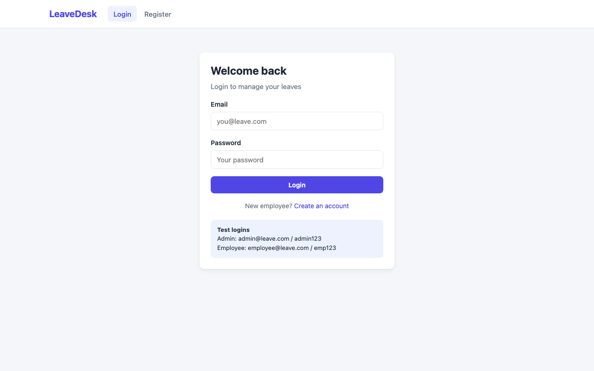
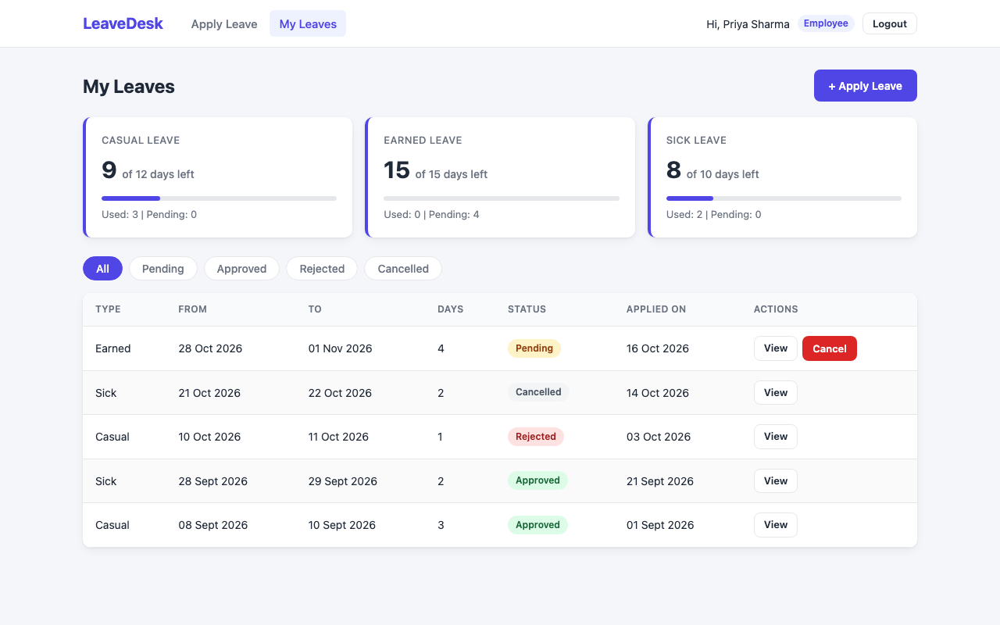
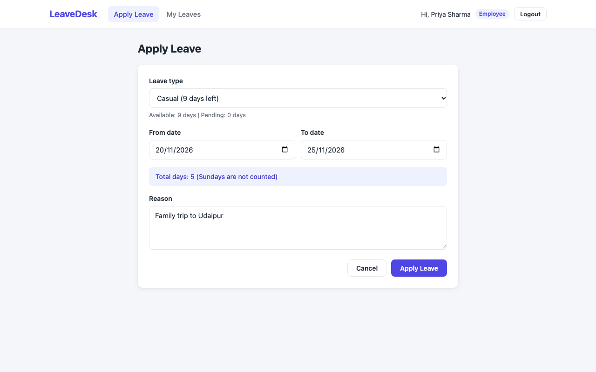
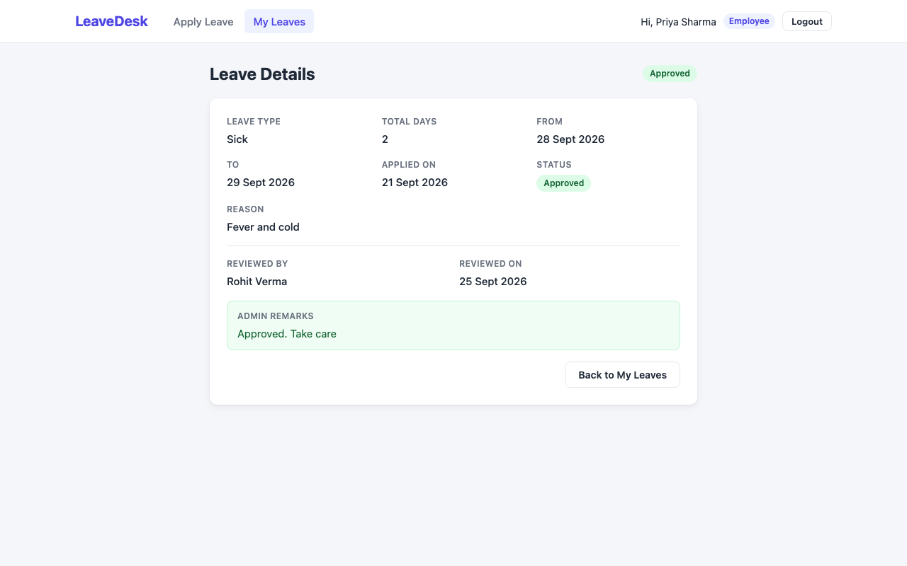
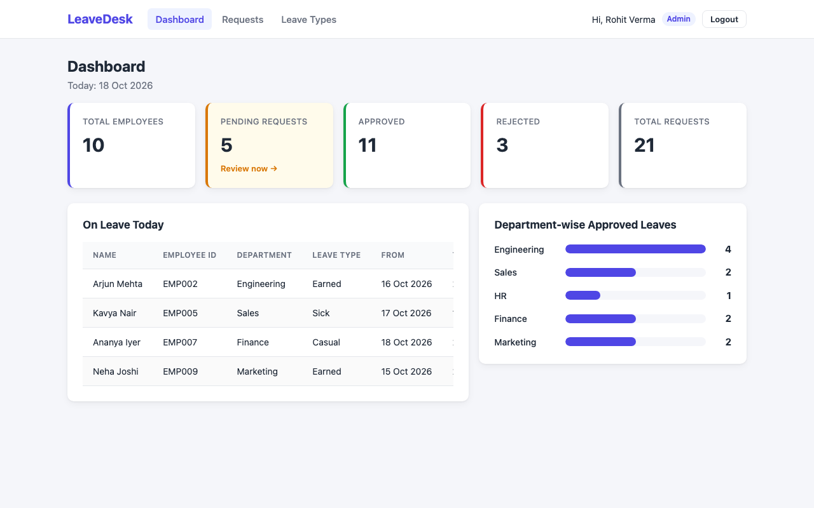
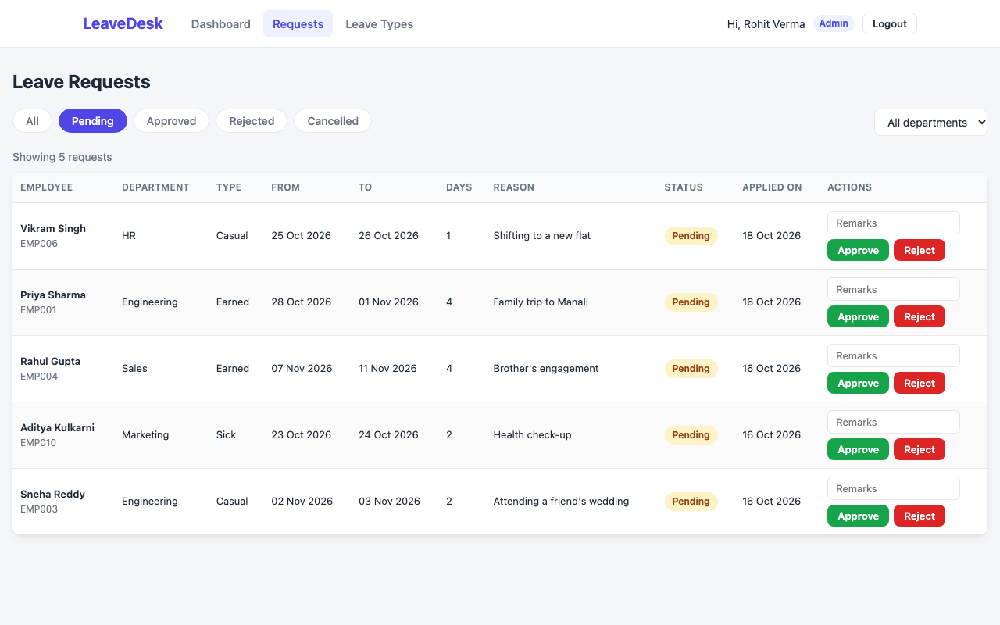
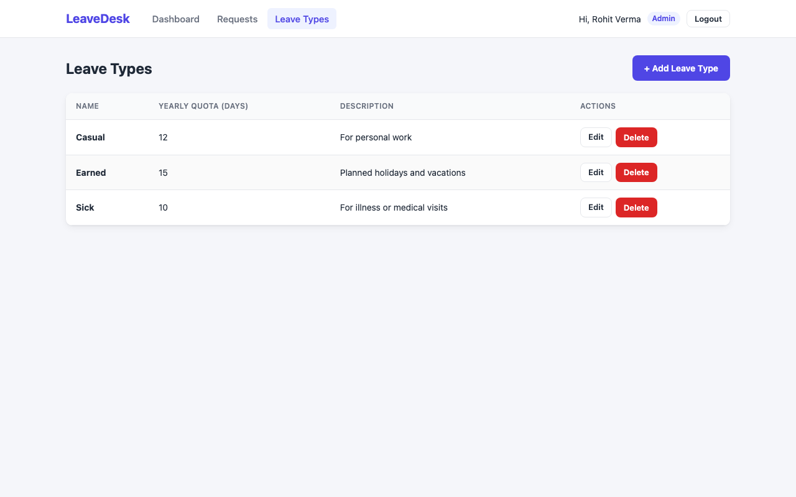
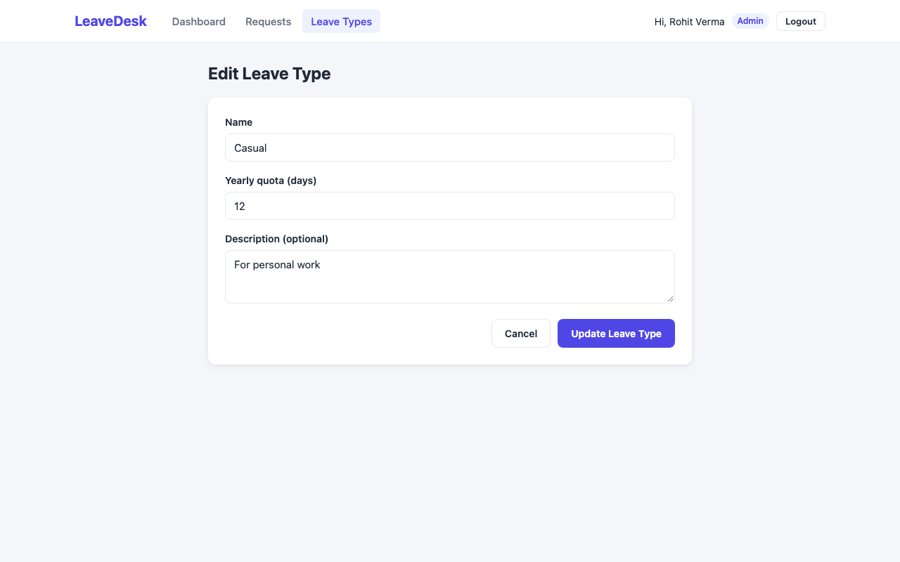

# LeaveDesk - Employee Leave Management System

A MERN web app where employees apply for leave online and the manager approves or rejects it, with leave balances calculated automatically.

## Problem Statement (PS4)

Employees apply for leave, managers approve or reject, and balances update automatically.

## Live Demo

| | Link |
|---|---|
| Frontend URL | https://leavedesk-ashen.vercel.app |
| Backend API URL | https://leavedesk-api-6aim.onrender.com |
| YouTube Demo | _to be added_ |

Note: the backend is on Render's free plan, so the first request after some idle time can take 30-60 seconds.

## Test Logins

| Role | Email | Password |
|---|---|---|
| Admin | admin@leave.com | admin123 |
| Employee | employee@leave.com | emp123 |

All other sample employees use the password `emp123` (for example `arjun.mehta@leave.com`).

## Features

### Employee
- Register and log in (JWT login, the session stays after a page refresh)
- Apply for leave with a live preview of the number of days
- See leave balance for every leave type (quota, used, pending, remaining)
- See the full leave history and filter it by status (the filter stays in the URL)
- Open one leave to see the details, the admin who reviewed it and the remarks
- Cancel a leave while it is still pending

### Admin (manager)
- Dashboard: total employees, request counts, who is on leave today and approved leaves per department (bar chart)
- See all leave requests, filter by status and department (filters stay in the URL)
- Approve or reject pending requests with remarks
- Add, edit and delete leave types (one shared form for add and edit)

### Business rules (all checked on the backend)
- All fields are required and the reason must be at least 5 characters
- The end date cannot be before the start date
- Leave cannot be applied for past dates (today is calculated in India time)
- A leave must start and end in the same year
- Two pending or approved leaves of the same employee cannot overlap
- Approved + pending days can never be more than the yearly quota of that leave type
- The balance is never stored; it is always calculated from approved leaves, so it goes down only when a leave is approved
- The balance is checked again when the admin approves
- Only pending leaves can be approved, rejected or cancelled
- Remarks are required when rejecting
- An employee can only see and cancel their own leaves
- A leave type that is used in leave requests cannot be deleted
- New users always get the "employee" role; the admin account comes from the seed script

### Stretch goal
- Sundays are not counted in leave days (for example, Friday to Tuesday = 4 days)

## Tech Stack

| Part | Technology |
|---|---|
| Frontend | React (Vite), react-router-dom, fetch, plain CSS |
| Backend | Node.js, Express.js 5 |
| Database | MongoDB Atlas with Mongoose |
| Auth | JWT (jsonwebtoken) and bcrypt password hashing, role based access |
| Deployment | Render (backend), Vercel (frontend) |

## Folder Structure

```
leave-management/
├── backend/
│   ├── config/          db.js (MongoDB connection)
│   ├── controllers/     authController, leaveTypeController, leaveController, dashboardController
│   ├── middleware/      authHandler (JWT check + allowRoles), errorHandler (notFound + errors)
│   ├── models/          userModel, leaveTypeModel, leaveRequestModel
│   ├── routes/          authRoutes, leaveTypeRoutes, leaveRoutes, dashboardRoutes
│   ├── seed/            seed.js (sample data)
│   ├── utils/           createToken, leaveUtils (dates, days, balance)
│   ├── server.js
│   └── .env.example
├── frontend/
│   ├── src/
│   │   ├── api/         apiClient + one file per resource (every fetch call is here)
│   │   ├── components/  Navbar, ProtectedRoute, StatusBadge, LeaveTypeForm
│   │   ├── pages/       Login, Register, ApplyLeave, MyLeaves, LeaveDetails,
│   │   │                AdminDashboard, AdminRequests, LeaveTypes, AddLeaveType,
│   │   │                EditLeaveType, NotFound
│   │   ├── utils/       formatDate, countDays, getToday, getHomePath
│   │   ├── App.jsx      (all routes)
│   │   ├── main.jsx
│   │   └── index.css
│   ├── vercel.json
│   └── .env.example
└── docs/screenshots/
```

## Database Design

There are 3 collections. `LeaveRequest` is linked to `User` and `LeaveType` with ObjectId references.

```
User  1 ─────< LeaveRequest >───── 1  LeaveType
            (employee, reviewedBy)      (leaveType)
```

**User**

| Field | Type | Rules |
|---|---|---|
| name | String | required |
| email | String | required, unique, lowercase |
| password | String | required, min 6 (stored as a bcrypt hash) |
| role | String | "employee" or "admin", default "employee" |
| employeeId | String | required, unique |
| department | String | required |
| designation | String | required |
| joiningDate | Date | required |

**LeaveType**

| Field | Type | Rules |
|---|---|---|
| name | String | required, unique (Casual, Sick, Earned) |
| yearlyQuota | Number | required, min 1, max 60 |
| description | String | optional |

**LeaveRequest**

| Field | Type | Rules |
|---|---|---|
| employee | ObjectId → User | required |
| leaveType | ObjectId → LeaveType | required |
| fromDate, toDate | Date | required |
| days | Number | required, min 1 (calculated by the server) |
| reason | String | required, min 5 characters |
| status | String | pending, approved, rejected, cancelled (default pending) |
| adminRemarks | String | required when rejecting |
| reviewedBy | ObjectId → User | the admin who reviewed |
| reviewedAt | Date | when it was reviewed |

All models also have `createdAt` and `updatedAt` (timestamps).

## Status Workflow

```
                 ┌──> approved   (admin, balance goes down)
                 │
apply ──> pending ──> rejected   (admin, remarks required)
                 │
                 └──> cancelled  (employee, only while pending)
```

Once a leave is approved, rejected or cancelled, its status cannot change again.

## API Endpoints

Base URL: `/api`. Protected routes need the header `Authorization: Bearer <token>`.

| Method | Endpoint | Access | Description |
|---|---|---|---|
| POST | /api/auth/register | Public | Register a new employee |
| POST | /api/auth/login | Public | Log in and get a token |
| GET | /api/auth/me | Logged in | Get the logged in user |
| GET | /api/leave-types | Logged in | Get all leave types |
| GET | /api/leave-types/:id | Logged in | Get one leave type |
| POST | /api/leave-types | Admin | Create a leave type |
| PUT | /api/leave-types/:id | Admin | Update a leave type |
| DELETE | /api/leave-types/:id | Admin | Delete a leave type (only if not used) |
| POST | /api/leaves | Employee | Apply for leave |
| GET | /api/leaves/my | Employee | My leaves (optional `?status=`) |
| GET | /api/leaves/my/balance | Employee | My balance for every leave type this year |
| PATCH | /api/leaves/:id/cancel | Employee | Cancel my pending leave |
| GET | /api/leaves/:id | Employee (own) / Admin | Get one leave with full details |
| GET | /api/leaves | Admin | All leaves (optional `?status=` and `?department=`) |
| PATCH | /api/leaves/:id/review | Admin | Approve or reject (`{ status, adminRemarks }`) |
| GET | /api/dashboard | Admin | Dashboard numbers |

Errors are always JSON like `{ "message": "..." }` with status 400, 401, 403, 404, 409 or 500.

## Environment Variables

**backend/.env**

```
PORT=5000
MONGO_URI=your_mongodb_atlas_url
JWT_SECRET=your_secret_key
CLIENT_URL=http://localhost:5173
```

- `CLIENT_URL` is the frontend address allowed by CORS (use the Vercel URL after deploying).
- On a Mac, port 5000 is used by AirPlay Receiver, so use `PORT=5001` locally (and set `VITE_API_URL` to match).

**frontend/.env**

```
VITE_API_URL=http://localhost:5001/api
```

## Local Setup

1. Clone the project

   ```
   git clone https://github.com/saini16tanu/leave-management.git
   cd leave-management
   ```

2. Backend

   ```
   cd backend
   npm install
   cp .env.example .env      (then fill in MONGO_URI and JWT_SECRET)
   npm run seed              (adds sample users, leave types and leave requests)
   npm run dev
   ```

   You should see `MongoDB Connected` and `Server running on port ...`.

3. Frontend (in a new terminal)

   ```
   cd frontend
   npm install
   cp .env.example .env
   npm run dev
   ```

   Open http://localhost:5173 and log in with a test login from above.

## Screenshots

**Login**


**Employee - My Leaves with balance cards**


**Employee - Apply Leave with live day count**


**Employee - Leave Details with admin remarks**


**Admin - Dashboard**


**Admin - Leave Requests (approve or reject)**


**Admin - Leave Types**


**Admin - Edit Leave Type (same form as Add)**


## Author

- Name: Tanu Saini
- Roll Number: 84
- GitHub: https://github.com/saini16tanu
